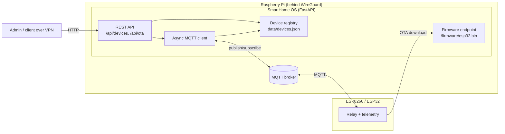

# SmartHome OS

> Local-first orchestrator for ESP8266/ESP32 devices over MQTT, built to run on a Raspberry Pi behind a WireGuard VPN.

## Overview

SmartHome OS is a small FastAPI service that manages low-cost ESP8266/ESP32
microcontrollers in a home network. It keeps a registry of devices and their
last-known state, relays commands to them over MQTT, and coordinates
over-the-air (OTA) firmware updates.

The design is intentionally local-first: the HTTP API, the MQTT broker, and the
firmware download endpoint are all expected to be reachable only over a private
network or a WireGuard VPN interface, rather than exposed to the public
internet.

The repository also includes an example Arduino sketch
(`firmware/example_esp8266.ino`) showing how a device connects to MQTT,
responds to relay commands, publishes telemetry, and performs an OTA update.

## Key features

- **Device registry** with a JSON-backed, lock-protected in-memory cache
  (`app/state/registry.py`).
- **REST API** (FastAPI) to list devices, register devices, and set relay
  values (`app/api/devices.py`).
- **MQTT integration** via `asyncio-mqtt`: a background task subscribes to
  device topics and merges relay/telemetry state into the registry
  (`app/mqtt/client.py`).
- **OTA update jobs**: publish an OTA command to one or many devices, track job
  status as devices report back, and serve the firmware binary over HTTP
  (`app/api/ota.py`, `/firmware/esp32.bin`).
- **Access control for OTA**: requests are permitted only from private/VPN IP
  ranges, or when a matching `X-API-KEY` header is supplied
  (`app/api/access.py`).
- **Deployment helpers**: virtualenv setup, a systemd unit, an installer, and a
  WireGuard key-generation helper under `scripts/`.

## Tech stack

- **Language:** Python 3 (orchestrator), C/Arduino (device firmware)
- **Web framework:** FastAPI + Uvicorn
- **Messaging:** MQTT via `asyncio-mqtt` (expects a broker such as Mosquitto)
- **Validation:** Pydantic
- **Testing:** Pytest + Starlette `TestClient`
- **Runtime target:** Raspberry Pi behind WireGuard

## Architecture



Message topics follow the pattern `home/demo/device/{deviceId}/...`:

- `.../relay/{id}/set` — command to a device relay
- `.../relay/{id}/state` — state reported by a device
- `.../telemetry` — periodic telemetry
- `.../ota` — OTA command
- `.../ota/status` — OTA progress reported by a device

## Project layout

```
app/
  main.py          # app factory, startup/shutdown wiring, firmware endpoint
  api/
    devices.py     # device list/register/relay endpoints
    ota.py         # OTA publish endpoint
    access.py      # private-IP / API-key access check
  mqtt/
    client.py      # asyncio-mqtt connection, subscribe loop, publish
    topics.py      # pure topic builders + incoming message parsing
  state/registry.py  # JSON-backed device and OTA job registry
tests/             # pytest (pure logic + TestClient API tests)
```

## Setup and run

Requirements: Python 3.10+, an MQTT broker (e.g. Mosquitto) reachable at the
configured host (defaults to `localhost:1883`).

```bash
# from the project root
python3 -m venv .venv
source .venv/bin/activate
pip install --upgrade pip
pip install -r requirements.txt

# run the orchestrator
uvicorn app.main:app --host 0.0.0.0 --port 8000
# (or: python -m app.main)
```

The `scripts/setup_venv.sh` helper performs the virtualenv steps above.
`scripts/install.sh` deploys the project under `/opt/smarthome-os` and installs
the `scripts/smarthome.service` systemd unit (Raspberry Pi).

### Run the tests

```bash
pip install -r requirements.txt
pytest
```

## Usage example

Register a device and turn on relay 1:

```bash
# register a device
curl -X POST http://localhost:8000/api/devices/register \
  -H "Content-Type: application/json" \
  -d '{"device_id": "demo-device-001", "meta": {"room": "office"}}'

# list devices and their cached state
curl http://localhost:8000/api/devices

# set relay 1 to ON (publishes an MQTT command)
curl -X POST "http://localhost:8000/api/devices/demo-device-001/relay/1/set?value=1"
```

Publish an OTA update (from a private/VPN IP, or with an API key):

```bash
export SMARTHOME_API_KEY=change-me   # optional; enables X-API-KEY access

curl -X POST http://localhost:8000/api/ota/publish \
  -H "Content-Type: application/json" \
  -H "X-API-KEY: change-me" \
  -d '{"device_ids": ["demo-device-001"], "version": "1.0.1"}'
```

If `url` is omitted, devices are told to download firmware from the
orchestrator's own `/firmware/esp32.bin` endpoint.

## Limitations / next steps

- The MQTT broker host is currently hard-coded to `localhost:1883` in
  `app/main.py`; broker host/port are not yet configurable via environment.
- No authentication is enforced on the device registry endpoints (`/api/devices`);
  only the OTA endpoint performs an access check. The project relies on network
  isolation (VPN / private network) for protection.
- The registry persists to a single JSON file and is not designed for large
  fleets or concurrent multi-process access.
- The example firmware uses naive string parsing for MQTT/JSON payloads and is
  marked as a minimal example to be hardened before production use.
- WireGuard and broker (Mosquitto) installation/configuration are out of scope
  and must be set up separately; `scripts/wireguard_setup.sh` only generates keys.
- No firmware binary (`firmware/esp32.bin`) is shipped in the repo; the OTA
  endpoint returns a "firmware not found" message until one is provided.

## License

Released under the MIT License. See [LICENSE](LICENSE).
